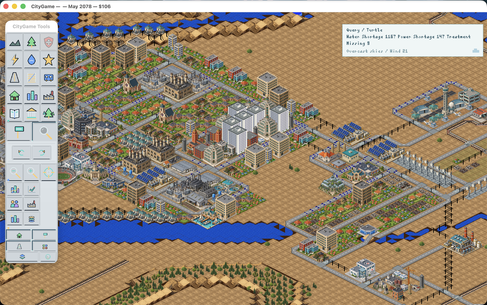
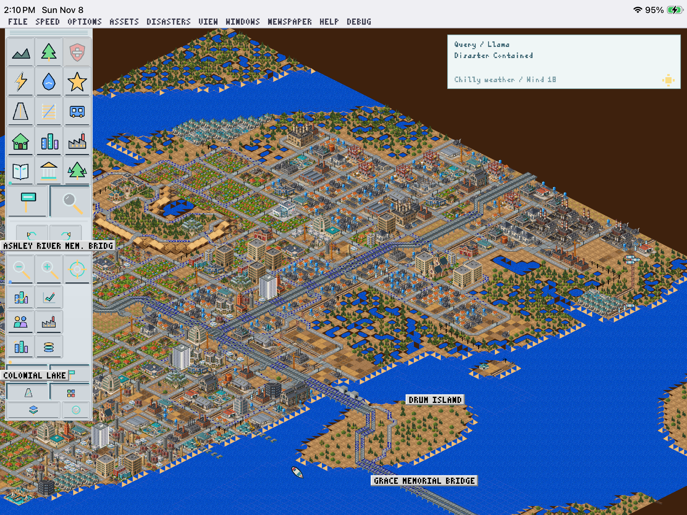

# CityGame

CityGame is a city-building game written in Rust. It can import city files and game media from a locally owned SimCity 2000™ installation. Imported files stay on your device.

## Screenshots

These screenshots show the included CityGame High-Res Pack in use.

**macOS**



**iPadOS**



## Build and run

Run commands from the repository root. A Rust toolchain and SDL3 development libraries are required for desktop builds.

### macOS

Install Xcode command-line tools, SDL3, and `pkg-config`.

```sh
cargo run --release
```

To build and open the named macOS app bundle with its CityGame icon:

```sh
./scripts/build_macos_app.sh
open target/CityGame.app
```

### Linux

Install Rust, SDL3 development libraries, and `pkg-config` (for example, `libsdl3-dev` on Debian-based distributions).

```sh
cargo run --release
```

Wayland is selected automatically when available. To install a desktop launcher for your user:

```sh
./scripts/install_linux.sh
```

### Windows

Install Rust with the MSVC toolchain, SDL3 development libraries, and a supported linker setup.

```powershell
cargo run --release
```

### iPadOS and Android

These are debug hosts, not store-ready releases. iPadOS requires Xcode, `xcodegen`, and the Apple Rust target; Android requires Android Studio/SDK, NDK, and `cargo-ndk`.

```sh
./scripts/build_ios_host.sh
./scripts/build_android_host.sh
```

## First launch and basic use

CityGame requires an import from a locally owned SimCity 2000™ installation. On first launch, choose **Asset Library → Import Game Edition** and select the installation folder. CityGame extracts its base assets into its application-support folder.

To use the included pack, enable **Prefer High-Res CityGame Graphics** and **Use CityGame Sounds** in the **Assets** menu. The Asset Library on the title screen has the same controls. Run the asset browser to inspect imported and authored packs.

```sh
cargo run --release -- --asset-browser
```

Open the local URL printed in the terminal. City files use the `.sc2` extension. Use **File → Save City** or **Save City As…** to save; returning to the title screen does not save automatically.

On iPadOS, **Load Saved City** opens Files and imports a working copy into **On My iPad → CityGame → Cities**. You can also open a `.sc2` directly from Files with CityGame. **Save City** and **Save City As…** open Files to export the current city as a `.sc2` file; after a successful export, CityGame keeps a local working copy for **Continue City**. Canceling the picker leaves the current city unchanged. Later edits are exported when you save again; external files are not edited in place.

## Tests

```sh
cargo test --lib
```

The default suite uses bundled numeric simulation cases under `tests/fixtures/` and authored assets. It needs no private documentation, original game installation, or imported city files. These fixtures contain test inputs and expected results, not executable game code or game media.

Three additional city import checks require locally owned city files and are ignored by default. To run them, set `CITYGAME_TEST_FLINT_SCENARIO` to an imported `FLINT.SCN` or `CITYGAME_TEST_VIRTUAL_CITY` to an imported `VIRTUALV.SC2`, then run the matching test with `-- --ignored`. For example:

```sh
CITYGAME_TEST_FLINT_SCENARIO=/path/to/FLINT.SCN cargo test --lib mac_actor_sweep_matches_native_on_imported_win95_flint_scenario -- --ignored
CITYGAME_TEST_VIRTUAL_CITY=/path/to/VIRTUALV.SC2 cargo test --lib imported_win95_city_ -- --ignored
```

An additional ignored graphics comparison accepts locally extracted `highway-reference-geometry.json` and `road-slope-reference-geometry.json` under `CITYGAME_TEST_GEOMETRY_DIR`. Run it with `cargo test --lib authored_roads_match_locally_supplied_geometry -- --ignored`. These reference masks are not bundled.

## Making CityGame assets

The CityGame High-Res Pack lives in `assets/replacements/our-graphics/`. To use a custom pack with an `asset-pack.json` manifest, choose **Asset Library → Choose CityGame Override Pack**, then enable **Prefer High-Res CityGame Graphics**. Add each asset to the manifest with a `citygame.*` key, a relative file path, and `status: "reviewed"`.

To include your own pack in a local macOS or mobile build, set `CITYGAME_REPLACEMENT_PACK=/path/to/your/pack` when running the build script. The game still needs imported graphics for any slots your pack does not replace.

- **Graphics:** add transparent PNGs. Keep the sprite's logical canvas and anchor aligned with the map slot; for high-resolution art, the PNG is typically 8× the logical width and height, while `logical_size` and `anchor` stay in logical pixels. Add the sprite key and dimensions to the manifest. Missing replacement slots continue to use the selected original pack.
- **Music:** CityGame's authored MIDI tracks are in `assets/music/`; the original theme and city music from a game installation are imported locally. Add authored MIDI cues to the bundled music source and register them in `src/title_music.rs` to include them in runtime playback. The title cue can be rendered to WAV for listening with `cargo run -- --render-title-theme /path/to/preview.wav`.
- **Sound effects:** replacement WAVs go under `audio/effects/` in a replacement pack and use `citygame.sound.<slot>` keys in its manifest. Keep them as short, non-looping PCM cues.

The asset browser can preview images and WAV files and compare packs. It runs locally and does not upload or modify assets. Avoid putting imported game files into public source control; keep only original or properly licensed CityGame-created work in a pack you share.

The artwork tests use the included pack by default. Set `CITYGAME_TEST_REPLACEMENT_ROOT=/path/to/your/pack` to test a different pack.
